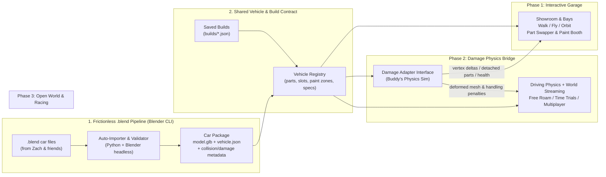

# Blend Garage — Architecture & Design Brainstorm

> **Status:** Stack direction aligned! Converging on **Web-first (TypeScript + Three.js)** with **Realistic-lite PBR**, **JS/TS/WASM damage physics integration**, and a **drop-in `.blend` folder + automated CLI import pipeline**. Ready to finalize a couple of implementation details and scaffold Phase 1.

---

## 0. Aligned Direction (Zach's Decisions)

- **Primary Target:** Web browser first (zero-install URL sharing, fast agent iteration).
- **Buddy's Damage Physics Sim:** JavaScript / TypeScript / WASM — drops straight into the web stack with zero native FFI glue!
- **Visual Style:** Realistic-lite PBR (crisp clearcoat/metallic car paint, studio HDRI reflections, clean garage lighting, smooth 60fps performance).
- **`.blend` Workflow:** Drop `.blend` files into a shared repo/folder (`cars/incoming/`) with an automated headless Blender CLI importer generating runtime Car Packages.

### Why This Stack Fits Like a Glove

- **Zero-friction Phase 2 physics:** Since the damage sim is JS/TS/WASM, it can live as a workspace package (`packages/damage-bridge`) and deform Three.js `BufferGeometry` vertex buffers directly—or run inside a **Web Worker** using transferable/`SharedArrayBuffer` float arrays to keep the main render thread locked at 60+ fps.
- **Renderer Path:** **Three.js** with **WebGL2 today + WebGPU-ready material/renderer abstraction** (Three.js's `WebGPURenderer` / `MeshPhysicalMaterial` pipeline), giving us immediate compatibility across every friend's browser while staying future-proof for WebGPU compute/instancing in Phase 3.
- **Imperative 3D Core + Thin UI Overlay:** Keeping the 3D scene, car loader, camera rigs, and physics loop in **pure TypeScript (`packages/garage-core` & `packages/vehicle-core`)** while using a lightweight **React + Tailwind HUD** for the paint booth, part swapper, and car picker gives agents the cleanest possible code separation and keeps the 60fps loop completely free of UI re-renders.
- **Agent-Friendly Verification:** Vite + TypeScript + Vitest (unit/schema tests) + Playwright (headless visual smoke checks of every imported car in the garage).

---

## 1. Vision & Phased Roadmap

1. **Phase 1 — Interactive Garage (Start Here)**
   - Drop in `.blend` car models built by Zach and friends.
   - Walk, fly, or orbit around all cars parked in a shared garage/showroom.
   - Customize cars: swap parts (wheels, spoilers, bumpers, hoods, etc.), change paint colors & finishes (gloss, metallic, matte, clearcoat, pearlescent), tweak materials, and save/share custom builds.
2. **Phase 2 — Car Damage Physics Add-on**
   - Cleanly integrate Zach's buddy's existing car damage physics simulation.
   - Support real-time (or crash-test) visual deformation, detachable parts, and mechanical damage feedback without rewriting the garage or car pipeline.
3. **Phase 3 — Open-World Free Roam & Racing Add-on**
   - Drive the exact same customized garage cars out into an open-world map for free roam, cruising, and racing (time trials, checkpoints, multiplayer).

---

## 2. Engine & Stack Comparison

All five options below can deliver this vision, but they make **very different trade-offs** on agent-friendliness, `.blend` ergonomics, custom physics integration, and sharing with friends.

| Dimension | **Web Stack** (Three.js / WebGPU + TypeScript) | **Godot 4** (Vulkan Forward+ + GDScript / C# / GDExtension) | **Bevy** (Rust ECS + wgpu) | **Unity** (C# + URP/HDRP) | **Unreal Engine 5** (C++ / Blueprints) |
| :--- | :--- | :--- | :--- | :--- | :--- |
| **Agent-Friendliness** | **10/10** — 100% text/code (TS/JSON/WGSL), instant HMR, Playwright & Vitest loops, zero opaque binary scenes. | **8.5/10** — `.tscn`/`.tres` are readable text, headless CLI import/test works well, lightweight repo. | **9/10** — 100% code-first Rust ECS, strong types, cargo test/CLI; slower incremental Rust compiles. | **5.5/10** — C# is great, but YAML scenes are GUID-heavy and fragile for agents; editor-centric workflow. | **3/10** — Binary `.uasset`/`.umap` & Blueprints, 50GB+ install, slow C++ compile/cook loops. |
| **Rendering Quality** | **7.5/10** — Great PBR clearcoat car paint & HDRI reflections; WebGPU unlocks modern shaders & instancing. | **8/10** — Strong Vulkan PBR, clearcoat, SSR/SDFGI, volumetric lighting; looks great with good HDRIs. | **7.5/10** — Modern PBR + clearcoat, native & WebGPU; fewer turnkey lighting/post-FX tools out of the box. | **9/10** — HDRP automotive look-dev is excellent; URP is fast and flexible. | **10/10** — Unmatched photorealism (Lumen, Nanite, automotive materials). |
| **`.blend` Pipeline** | Blender CLI converts `.blend` → `.glb` + `vehicle.json` (fast, deterministic, scriptable). | **Native `.blend` import** (calls Blender under the hood) + optional CLI validator/normalizer. | Blender CLI → `.glb` + `vehicle.json` (strong glTF support). | Imports `.blend` (via local Blender) or `.glb` via glTFast. | glTF / FBX / Datasmith bridge; heavier to automate cleanly. |
| **Custom Damage Sim Integration** | C++/Rust → **WASM** (runs in-browser/Web Worker); Python/native via local WebSocket sidecar during dev. | **Native GDExtension (C / C++ / Rust)** with direct mesh vertex buffer access; easy IPC for Python. | **First-class for Rust & C/C++** (direct crate/FFI + ECS vertex mutation); can also compile to WASM. | Native C/C++/Rust DLL (`DllImport`) + Jobs/Burst for mesh updates. | Native C++ plugin is strong if buddy's sim is C++; awkward for Python/Rust. |
| **Open World & Racing (Phase 3)** | Good for stylized or mid-scale open worlds (chunked streaming + WebGPU + Rapier/custom vehicle physics); more DIY tooling. | Strong desktop performance, Jolt Physics + custom raycast suspension, threaded chunk loading, built-in scene/terrain tools. | Very fast runtime, but terrain/world-building tools are mostly DIY (or built in Blender). | Mature ecosystem (Addressables streaming, proven vehicle physics assets). | **Best-in-class** (World Partition, Chaos Vehicles, Landscape tools). |
| **Sharing & Multiplayer** | **10/10** — Instant URL sharing with zero installs; trivial WebSocket/WebRTC cruising. | **8/10** — Small desktop builds + built-in MultiplayerAPI (ENet/WebRTC); Web export exists but has native-extension caveats. | **7.5/10** — Native desktop + optional WASM web builds; networking is crate-based (`renet`/`lightyear`). | **7/10** — Desktop or WebGL builds; larger install/tooling overhead. | **5/10** — Multi-GB desktop downloads; highest friction for friends dropping in. |

### Quick Take on the Top Contenders

- **Option A — Web Stack (Three.js / WebGPU + TypeScript + Blender CLI Importer)**
  - *Best if:* You want **maximum coding-agent velocity**, instant zero-install sharing with friends (just open a link to explore the garage), and your buddy's damage sim can compile to **WASM** (C++/Rust) or talk over a local bridge.
  - *Watch-out:* Phase 3 open-world scale and raw CPU/SIMD throughput for ultra-heavy soft-body physics are more constrained in a browser than native desktop (though WebGPU + WASM SIMD + Web Workers go surprisingly far).
- **Option B — Godot 4 (Vulkan Desktop + GDExtension + Blender CLI Importer)**
  - *Best if:* You want a **real native desktop game engine** that stays genuinely **agent-friendly**, has native `.blend` support, gives zero-overhead C++/Rust native hooks for heavy real-time damage physics, and scales naturally into an open-world racing game with built-in editor/terrain/networking tools.
  - *Watch-out:* Friends download a lightweight desktop app (or run locally) instead of clicking a browser link; web export doesn't easily mix with heavy native GDExtensions.
- **Option C — Bevy (Rust ECS + wgpu)**
  - *Best if:* Your buddy's damage physics sim is in **Rust or C++**, you love pure code-first architecture, and you want a single codebase that can target **both native desktop and Web/WASM**.
  - *Watch-out:* Less turnkey visual editor/world-building tooling than Godot; Rust compile times require careful workspace setup to keep agent iteration snappy.
- **Option D — Hybrid / Dual-Stage Path (Optional)**
  - Because the **`.blend` Car Pipeline** and **`Car Package` spec** are completely engine-agnostic (`.glb` + JSON manifests), you can keep all assets, part definitions, and physics contracts decoupled from the renderer. Even if you start fast in Web or Godot, your car library is never locked into a single engine.

---

## 3. Engine-Agnostic Architecture (Keeping Phases 1, 2 & 3 Clean)

Regardless of which engine we pick, structuring the repo around **four clean boundaries** ensures Phase 1 stays simple while Phase 2 and Phase 3 plug in cleanly without rewrites.



### 3.1 Frictionless `.blend` Import Pipeline

The goal: **anyone drops a `.blend` file into a folder (or uploads it), runs one command (or lets a watcher run), and the car appears in the garage.**

How the headless Blender CLI pipeline (`tools/car-importer/`) makes this effortless:
1. **Auto-Normalization:** Sets consistent real-world scale (meters), consistent forward axis, centers `X/Y`, and grounds tires cleanly at `Z = 0` so cars never float or clip through the garage floor.
2. **Convention-Based Auto-Rigging (Zero Boilerplate in Blender):**
   - **Wheels:** Objects named `wheel_FL`, `wheel_FR`, `wheel_RL`, `wheel_RR` (optionally split into `rim_*`, `tire_*`, `caliper_*`) automatically get pivot points centered for spinning, steering, and wheel swapping.
   - **Swappable Parts:** Prefixes like `part_hood`, `part_bumper_front`, `part_bumper_rear`, `part_spoiler`, `part_exhaust`, `part_door_FL` are automatically recognized as removable/swappable panels.
   - **Mount Slots:** Optional Blender Empties named `slot_spoiler`, `slot_wheels`, `slot_roof`, `slot_exhaust` let universal aftermarket parts snap onto *any* friend's car automatically.
   - **Paint & Material Zones:** Materials named with prefixes like `mat_paint_primary`, `mat_paint_secondary`, `mat_paint_accent`, `mat_glass`, `mat_trim`, `mat_headlight`, `mat_taillight` automatically wire up to the garage's paint booth (color, metallic, roughness, clearcoat, pearlescent).
3. **Graceful Fallback for "Messy" `.blend` Files:**
   - If a friend drops in a `.blend` that doesn't follow any naming conventions, it **still imports and parks in the garage** immediately! The importer generates a default `vehicle.json` listing detected meshes/materials and prints a concise checklist of optional renames to unlock steering wheels, part swapping, or damage zones.
4. **Output Car Package (`cars/<car-id>/`):**
   - `model.glb` — clean runtime mesh with preserved hierarchy & PBR materials
   - `vehicle.json` — dimensions, wheel positions, part list, paint slots, author credits, handling/mass defaults
   - `collision.glb` / `damage_proxy.json` — simplified proxy geometry or panel mapping prepared for Phase 2
   - `thumbnail.png` — auto-rendered preview image for the garage car selector UI

### 3.2 Phase 2 Boundary — Buddy's Car Damage Physics Sim

To avoid tangling the damage simulation into the rendering engine, we define a strict **Damage Physics Adapter** interface early:

- **Initialization:** Game hands the sim the car's `damage_proxy` / mesh vertex buffers + structural parameters (panel attachment points, mass, material stiffness).
- **Step / Impact Input:** Game feeds either per-frame rigidbody forces/contacts or impact events `(position, normal, impulse, relativeVelocity)`.
- **Simulation Output:**
  - Deformed vertex positions (or bone/node transforms) to update the visual mesh on GPU/CPU
  - Panel/part detachment events (e.g., `part_bumper_front` pops off and becomes a loose physics prop!)
  - Mechanical state modifiers for Phase 3 (wheel alignment bend, steering pull, tire burst, power loss, headlight/taillight failure)

**How we connect it depending on the buddy's implementation:**
- **C / C++:** Direct native GDExtension (Godot), FFI (Bevy/Unity/UE), or Emscripten → **WASM** (Web).
- **Rust:** Direct crate (Bevy), `gdext` (Godot), C-ABI DLL (Unity/UE), or `wasm-bindgen` → **WASM** (Web).
- **Python:** Local IPC / WebSocket / shared-memory bridge for rapid Phase 2 prototyping; optionally compile hot loops (Cython/Rust/C++) later for 60Hz+ real-time driving.

### 3.3 Phase 3 Readiness — Open World & Racing

- **Garage-as-Hub:** The garage isn't just a separate menu—in Phase 3 it becomes a physical location you can literally drive out of onto the road.
- **Shared Car Spawner:** One function loads `cars/<id>/` + `builds/<build>.json` into either a static garage display rig (Phase 1) or a drivable, damageable vehicle rig (Phase 2/3).
- **Modular Add-on Layout:** Keep `garage/`, `damage-sim/`, and `world-racing/` as separate modules/packages sharing `vehicle-core/` so Phase 1 stays lean and fast.

---

## 4. Extremely Agent-Friendly Repo Structure

No matter the engine, we should design the repo so coding agents (and humans) can inspect, build, test, and iterate effortlessly:

```text
blend-garage/
├── AGENTS.md                 # Clear conventions, commands, and architecture rules
├── schemas/                  # JSON Schemas for vehicle.json, part.json, build.json
├── tools/
│   └── car-importer/         # Headless Blender CLI converter, validator & thumbnailer
├── cars/
│   ├── incoming/             # Drop .blend files here
│   └── <car-id>/             # Generated Car Packages (.glb + vehicle.json + preview)
├── parts/                    # Shared swappable parts catalog (wheels, spoilers, etc.)
├── builds/                   # Saved custom car configurations (JSON)
├── packages/ (or modules/)
│   ├── vehicle-core/         # Data loaders, paint/material binder, part swapper
│   ├── garage-app/           # Phase 1: Showroom, cameras, paint booth, part UI
│   ├── damage-bridge/        # Phase 2: Adapter interface + buddy's sim integration
│   └── world-racing/         # Phase 3: Driving physics, world streaming, races
└── tests/                    # Headless validation, unit tests, visual smoke captures
```

Key agent-friendly habits from Day 1:
- **Single-command workflows** (`import`, `validate`, `dev`, `test`, `screenshot`).
- **Schema-validated JSON** for cars, parts, builds, and damage configs so agents catch mistakes immediately.
- **Headless smoke tests + automated screenshots** so an agent can verify that a newly imported `.blend` renders properly, sits flush on the floor, and accepts paint/part swaps.

---

## 5. Concrete Web Stack Blueprint (Ready to Scaffold)

### Tech Stack
- **Build & Workspace:** npm/pnpm workspaces + **Vite** + **TypeScript** (strict mode)
- **3D Renderer:** **Three.js** (`MeshPhysicalMaterial` for automotive clearcoat, metallic flake, iridescence/pearlescence, glass transmission; procedural/HDRI studio PMREM environment lighting; soft grounded shadows)
- **Scene/UI Split:** Pure TypeScript imperative 3D core (`packages/vehicle-core`, `packages/garage-scene`) + thin **React + Tailwind** HUD overlay (paint booth, part swapper, garage bay navigator, camera switcher)
- **`.blend` Pipeline:** `tools/car-importer/` — Python script executed by headless Blender (`blender --background <file.blend> --python import_car.py`) + Node CLI wrapper (`npm run import-cars` / `npm run watch-cars`) that auto-detects Blender, validates naming conventions, exports optimized `.glb` + `vehicle.json`, and prints actionable tips for any untagged parts.
- **Physics & Damage Readiness:**
  - **Phase 2 (`packages/damage-bridge`):** Clean `DamageSimulator` interface expecting/returning typed arrays (`Float32Array` vertex deltas, part detach events, wheel/chassis health) so your buddy's JS/TS/WASM sim plugs in directly (main thread or Web Worker).
  - **Phase 3 (`packages/world-racing`):** Modular driving physics (e.g., Rapier WASM or custom raycast suspension) + chunked road/terrain streaming reusing the exact same `Car Package` and `Build JSON`.
- **Testing & Agent Loop:** **Vitest** (manifest schemas, part-slot resolution, paint bindings, importer tests) + **Playwright** (automated headless garage boot + screenshot smoke check).

### Proposed Monorepo Layout

```text
D:\Blend Garage\
├── AGENTS.md                        # Agent instructions, commands & conventions
├── package.json                     # Workspace scripts (dev, import-cars, validate, test, build)
├── cars/
│   ├── incoming/                    # Friends drop .blend files here
│   ├── manifest.json                # Auto-generated index of all imported garage cars
│   └── <car-id>/
│       ├── model.glb                # Normalized runtime car mesh
│       ├── vehicle.json             # Dimensions, wheels, swappable parts, paint zones, author
│       └── source.meta.json         # Import report & optional tagging hints
├── parts/                           # Universal swappable parts (rims, spoilers, exhausts)
├── builds/                          # Saved custom car builds (paint + swapped parts JSON)
├── tools/
│   └── car-importer/                # Blender CLI Python converter + Node watcher/validator
├── packages/
│   ├── vehicle-core/                # Vehicle schema, GLB loader, paint/finish engine, part swapper
│   ├── damage-bridge/               # Phase 2 contract & adapter stub for buddy's JS/TS/WASM sim
│   └── world-racing/                # Phase 3 placeholder boundary (driving & open-world)
└── apps/
    └── garage-web/                  # Phase 1 Interactive Garage web app (Three.js + React HUD)
```

### Proposed Starting Milestones (Phase 1 MVP First)

1. **Milestone 0 — Scaffold & Contracts:** Set up the TypeScript workspace, JSON schemas (`vehicle.json`, `build.json`), `AGENTS.md`, and the `DamageSimulator` interface stub.
2. **Milestone 1 — Headless `.blend` Importer + Starter Cars:** Build `tools/car-importer/` (`npm run import-cars` + folder watcher) and include 2 clean starter cars (generated procedurally or imported from Zach's existing `.blend`s) so the garage works out of the box immediately.
3. **Milestone 2 — Interactive Garage MVP:** Lit PBR showroom with auto-arranged parking bays that expand as you add cars, smooth **Orbit**, **First-Person Walk (WASD)**, and **Free-Fly** cameras, plus click-to-focus on any car.
4. **Milestone 3 — Paint Booth & Part Swapper:** Real-time automotive paint editor (base color, metallic, roughness, clearcoat, pearlescent/iridescence, wheel/accent colors) + toggle/swap parts (wheels, spoilers, bumpers, hoods) + save/load/share custom `build.json` presets.
5. **Milestone 4 — Phase 2 Crash-Test Arena:** Dedicated proving-ground mode in the same app where your buddy's JS/TS/WASM damage sim plugs directly into `packages/damage-bridge` to deform any garage car in real time.
6. **Milestone 5 — Phase 3 Open-World & Racing:** Drive straight out of the garage door onto a starter road network with raycast suspension driving physics, checkpoints/time trials, and optional WebRTC/WebSocket cruising.

---

## 6. Next Decisions Before Scaffolding

1. **3D/UI architecture preference:** Pure TypeScript Three.js core + thin React/Tailwind HUD *(recommended for Phase 2/3 physics/WASM performance)* vs React Three Fiber (R3F).
2. **Starting `.blend` models:** Do you already have `.blend` car files ready to drop in and test right away, or should we start with procedural starter cars while keeping the `.blend` importer ready for your first drop?
3. **Ready to build?** Should we jump straight into scaffolding Milestone 0 + Phase 1 Garage MVP now, or inspect your buddy's damage sim API first so the `damage-bridge` contract matches it from line 1?
